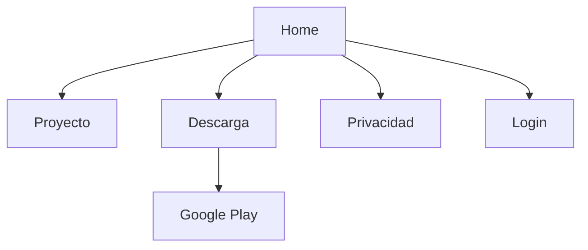
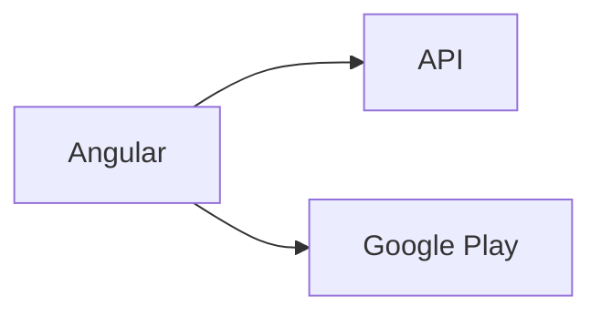
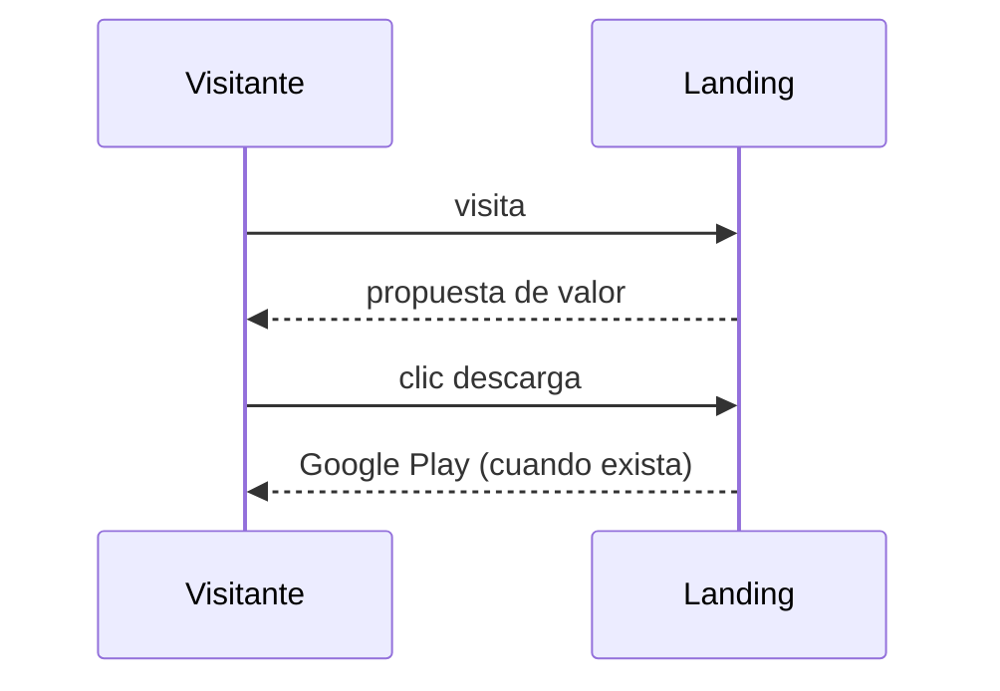

# Diagramas — Landing pública, descarga, privacidad y accesibilidad

> Spec: `spec.md` · Plan: `plan.md`. Diagramas Mermaid; no representan recursos desplegados.

## 1. Flujo funcional

## 2. Relación entre componentes

## 3. Flujo de datos / secuencia

## 4. Notas

La landing pública no existe; el enlace de tienda está pendiente.
