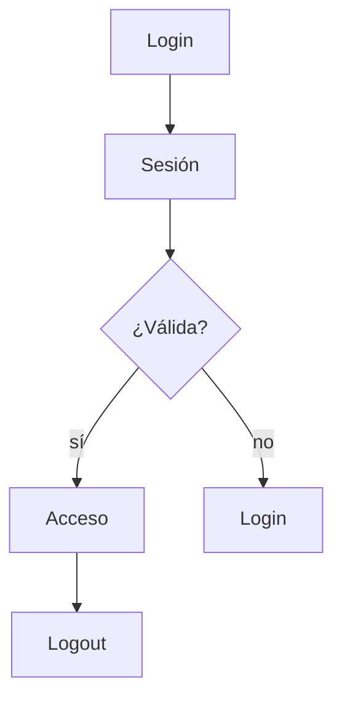
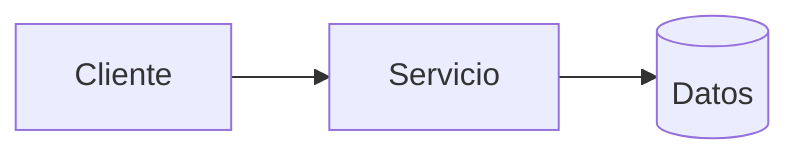
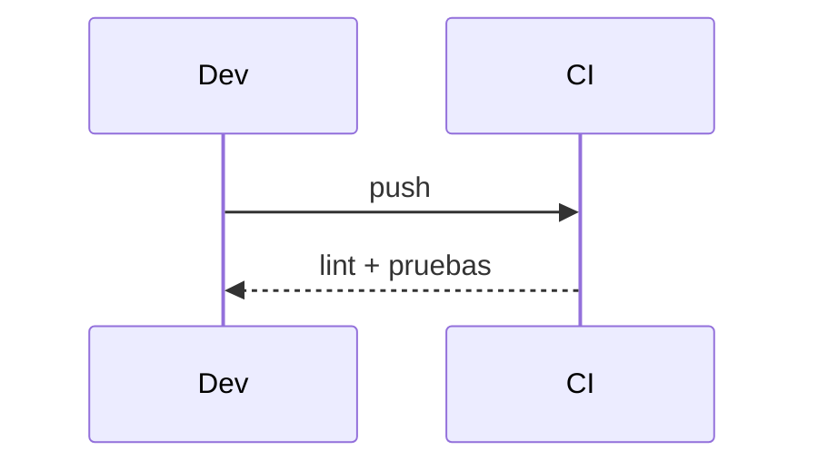

# Diagramas — 05-gestion-de-sesiones — Gestión de sesiones del portal

> Spec: `spec.md` · Plan: `plan.md`.

## 1. Flujo funcional

## 2. Componentes

## 3. Secuencia

## 4. Notas

La decisión de sesión SPA sigue abierta.
