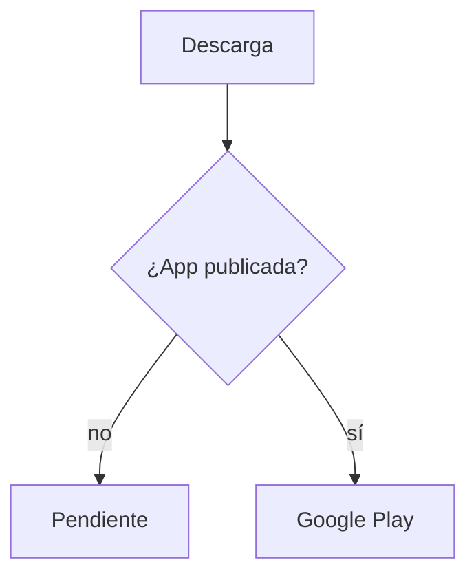
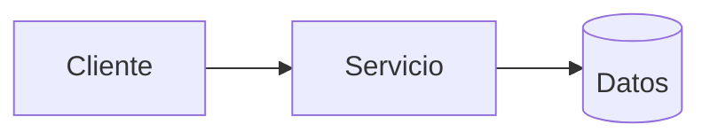
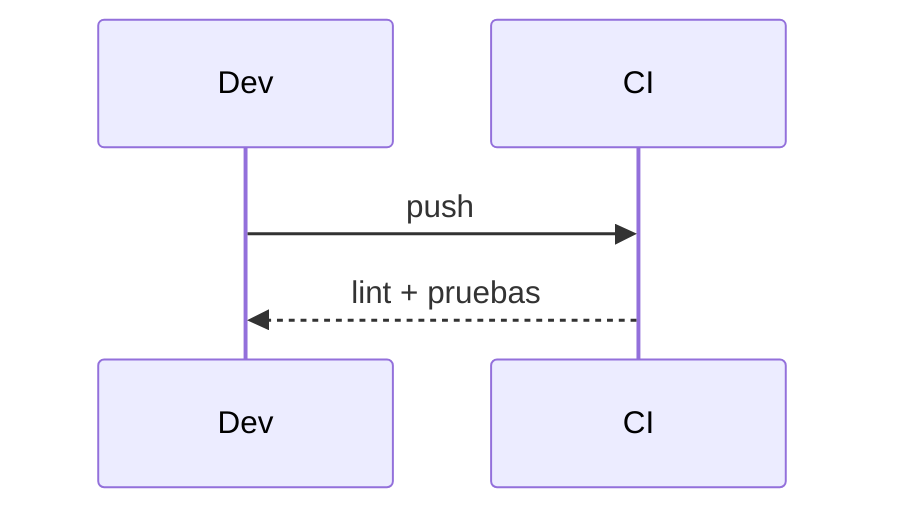

# Diagramas — 08-enlace-de-descarga — Enlace de descarga a Google Play

> Spec: `spec.md` · Plan: `plan.md`.

## 1. Flujo funcional

## 2. Componentes

## 3. Secuencia

## 4. Notas

No hay app publicada ni URL de tienda verificada.
