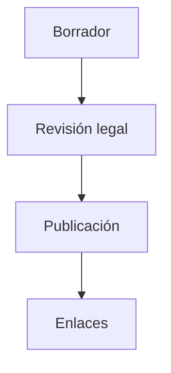
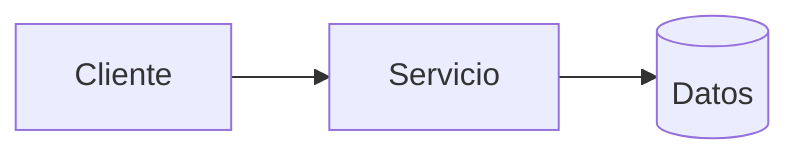
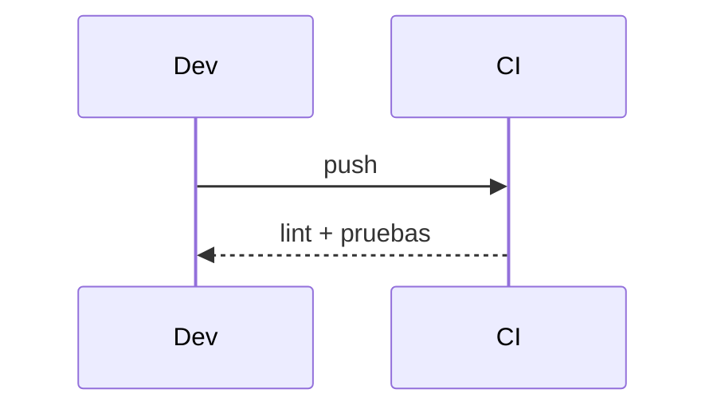

# Diagramas — 09-aviso-de-privacidad-y-terminos — Aviso de privacidad y términos

> Spec: `spec.md` · Plan: `plan.md`.

## 1. Flujo funcional

## 2. Componentes

## 3. Secuencia

## 4. Notas

Requiere revisión legal antes de publicar.
