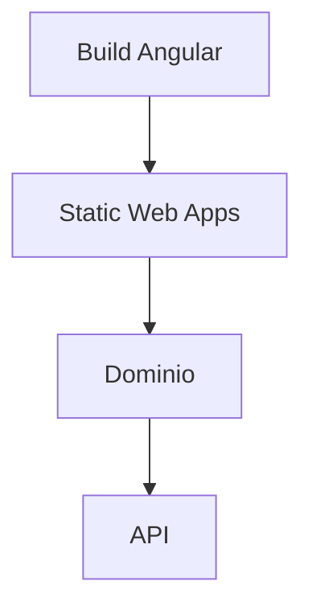
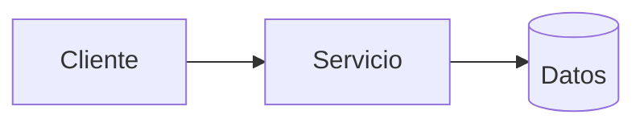
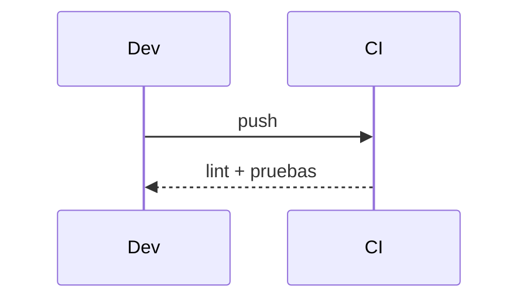

# Diagramas — 12-publicacion-en-azure-static-web-apps — Publicación en Azure Static Web Apps

> Spec: `spec.md` · Plan: `plan.md`.

## 1. Flujo funcional

## 2. Componentes

## 3. Secuencia

## 4. Notas

Propuesta; no hay despliegue.
